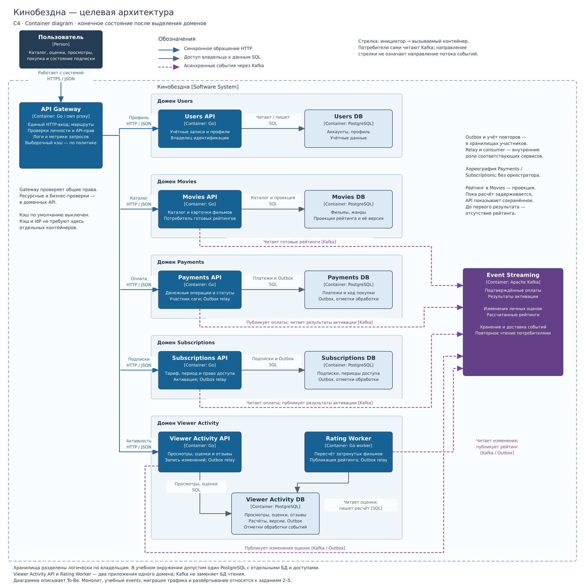

## Изучите [README.md](README.md) файл и структуру проекта.

## Задание 1

1. Спроектируйте to be архитектуру КиноБездны, разделив всю систему на отдельные домены и организовав интеграционное взаимодействие и единую точку вызова сервисов.
Результат представьте в виде контейнерной диаграммы в нотации С4.
Добавьте ссылку на файл в этот шаблон

### Решение

**Контейнерная диаграмма C4:** [просмотр SVG](docs/architecture/diagrams/cinema-to-be-containers.svg), [редактируемый исходник drawio](docs/architecture/diagrams/cinema-to-be-containers.drawio).



В To-Be выделены пять доменов. Для API и фонового расчёта выбран Go, для данных — PostgreSQL, для событий — Kafka. Контейнер C4 обозначает приложение или хранилище; граница домена объединяет принадлежащие ему контейнеры.

| Домен | Приложения | Собственные данные |
|---|---|---|
| Users | Users API | Аккаунты, профили, учётные данные; ответственность за идентификацию |
| Movies | Movies API и встроенный потребитель рейтинга | Метаданные фильмов, жанры, готовая проекция рейтинга |
| Payments | Payments API и обработчики событий покупки | Платежи, состояние оплаты и полученный результат активации |
| Subscriptions | Subscriptions API и обработчики активации | Тарифы, периоды и право доступа |
| Viewer Activity | Viewer Activity API; отдельный Rating Worker | Просмотры, личные оценки, отзывы, результаты расчёта |

Каждый домен владеет отдельной логической БД. Для учебного окружения достаточно одного экземпляра PostgreSQL с отдельными БД и доступами. Другие домены обращаются через API или события, без междоменных SQL-запросов и внешних ключей. API зрительской активности и воркер делят БД своего домена; отдельного домена Ratings не требуется. Обоснование минимального состава, альтернативы и условия пересмотра: [ADR 010 — контейнеры To-Be](docs/architecture/decisions/010-minimal-container-topology.md).

Единая точка входа — **API Gateway**. Он маршрутизирует запросы, обеспечивает общие логи и метрики, выборочное кэширование, аутентификацию и авторизацию на уровне доступа к API. Проверки прав на конкретные объекты и бизнес-правила остаются у доменных сервисов. Клиент использует HTTPS/JSON, Gateway обращается к доменным API по HTTP/JSON. Фоновые процессы и Kafka требуют собственной наблюдаемости. Кэш по умолчанию выключен до выбора политики и подтверждения потребности; отдельный Redis не добавляется. Владелец идентификации — Users, без отдельного IdP; формат токенов уточняется при реализации. Обоснование и границы ответственности: [ADR 009 — API Gateway](docs/architecture/decisions/009-api-gateway-responsibilities.md).

Для задания 2 выбран собственный proxy на Go в `src/microservices/proxy` с переключением трафика по флагу; задания 3–4 обеспечивают его сборку и развёртывание. Kong оставлен как готовая альтернатива для последующей замены при сохранении и проверке контрактов. Istio поддерживает маршрутизацию по заголовкам и весам; это полезно для переключения трафика, но не заменяет все флаги бизнес-функций. В задании 2 долей трафика управляет proxy, в задании 5 добавляется Istio Circuit Breaker. При передаче распределения трафика Istio аналогичное распределение в proxy нужно отключить. Полный вход пользователей и выпуск токенов не входят в обязательный объём заданий 2–5; целевые обязанности Gateway и объём учебной реализации различаются. Основания и ссылки на документацию — в ADR 010.

Границы сервисов и владения данными строятся по доменам. Каждый владелец изменяет своё хранилище; другие домены получают нужные данные через API или события. Для согласования покупки между Payments и Subscriptions выбран паттерн **Saga**: локальные транзакции должны довести общий процесс до завершения либо предусмотренной бизнес-правилами компенсации. Между шагами допускается временное рассогласование. Обоснование и границы решения: [ADR 007 — данные доменов и Saga покупки](docs/architecture/decisions/007-domain-data-and-purchase-saga.md). Конкретные компенсации и наблюдение за незавершёнными покупками предстоит определить.

В части платежей и подписок выбраны два домена: **Payments** отвечает за денежные операции, их суммы и состояния; **Subscriptions** — за тариф и период доступа пользователя. В целевом сценарии покупки подписки домены взаимодействуют, при этом их бизнес-правила и жизненные циклы различаются. Разделение позволяет развивать модели отдельно и требует явно описать их взаимодействие.

Обоснование, альтернатива единого Billing, последствия и условия пересмотра: [ADR 001 — разделение Payments и Subscriptions](docs/architecture/decisions/001-payments-subscriptions-domains.md).

Для активации подписки выбрано асинхронное взаимодействие: Payments публикует событие подтверждённой оплаты в Kafka, Subscriptions получает его и применяет соответствующее изменение доступа. Это позволяет обработать оплату после временной недоступности Subscriptions при условии надёжной публикации и хранения события: [ADR 005 — активация подписки по событию оплаты](docs/architecture/decisions/005-payment-subscription-events.md).

Сага координируется через **хореографию**: каждый участник реагирует на события и публикует результат своего шага. Для короткой цепочки Payments → Kafka → Subscriptions дополнительная логика оркестратора пока не обоснована. При появлении сложных ветвлений, общих сроков или нескольких вариантов компенсации выбор пересматривается. Сравнение подходов, последствия и границы решения: [ADR 008 — хореография покупки подписки](docs/architecture/decisions/008-purchase-saga-choreography.md).

Надёжная публикация организуется через **Transactional Outbox**: Payments сохраняет подтверждённый платёж и исходящее событие одной транзакцией, фоновый отправитель передаёт событие в Kafka с повторными попытками. Subscriptions фиксирует изменение подписки и факт обработки своей локальной транзакцией, чтобы повтор не применял тот же платёж ещё раз. Это закрывает сбой между записью платежа и отправкой; подтверждение Kafka при этом ещё не означает активацию подписки. Обоснование, альтернативы и границы гарантий: [ADR 006 — Outbox для событий оплаты](docs/architecture/decisions/006-payment-transactional-outbox.md). Outbox обеспечивает публикацию событий шагов саги. Политика хранения, контроль задержек и восстановление незавершённых активаций требуют дальнейшей детализации; Event Sourcing не выбран.

**Movies** отвечает за каталог и метаданные фильмов; **Viewer Activity** — за историю просмотров и личные оценки с отзывами. Разделение основано на разных правилах описания фильма и действий конкретного зрителя. Предполагаемая разница частоты изменений — дополнительный аргумент; нагрузка пока не измерена. У обоих доменов есть сценарии чтения и записи.

Обоснование, альтернатива общего домена и граница решения: [ADR 002 — разделение каталога и зрительской активности](docs/architecture/decisions/002-movies-viewer-activity-domains.md). Общий рейтинг в карточке будет вычисляться по оценкам пользователей CinemaAbyss; текущее поле `movies.rating` пока хранит независимо заданное значение.

Для общего рейтинга выбрана отдельная вычисляемая модель чтения. Изменение личной оценки вызывает событие в Kafka; отдельный Rating Worker внутри Viewer Activity пересчитывает рейтинг затронутого фильма, публикует результат через Kafka и продолжает обработку событий. В минимальном варианте рейтинг — среднее арифметическое текущих личных оценок. Это позволяет направлять вычисления на изменившиеся данные и выполнять расчёт отдельно от запроса карточки. Рекомендации и профили интересов не входят в ответственность обработчика. Решение и альтернативы: [ADR 003 — пересчёт рейтинга по событиям](docs/architecture/decisions/003-rating-recalculation-events.md); размещение воркера и требования к версиям результата уточнены в ADR 010.

Потребитель в Movies сохраняет полученный рейтинг в своём PostgreSQL. API карточки читает эту персистентную проекцию обычным запросом к БД; вычисление рейтинга остаётся в Viewer Activity. Это отделяет выдачу карточки от доступности обработчика и Kafka, пока API и БД Movies работают. Обоснование и альтернативы: [ADR 004 — модель чтения рейтинга в Movies](docs/architecture/decisions/004-rating-read-projection.md).

Карточка показывает последний успешно рассчитанный рейтинг, в том числе во время нового расчёта или сбоя обработчика. До первого сформированного результата рейтинга ещё нет; отсутствие значения не подменяется нулём.

**Задание 1 выполнено на уровне проектирования:** домены, владельцы данных, контейнеры и интеграции определены; диаграмма и её исходник приведены выше. Синхронные запросы проходят через Gateway, асинхронные бизнес-потоки — через Kafka. На диаграмме стрелки показывают инициатора обращения, поэтому потребители направляют обращение к Kafka; подписи описывают публикуемые и читаемые события.

Диаграмма показывает конечную To-Be архитектуру. Монолит и учебный events относятся к переходу по заданиям 2–5. Детали контрактов событий, компенсаций, сроков хранения и требований к доступности уточняются перед реализацией соответствующих сценариев. Реализация целевых сервисов, разделение текущей общей БД и runtime-проверки в задание 1 не входят и здесь не заявляются как выполненные.


## Задание 2

### 1. Proxy
Команда КиноБездны уже выделила сервис метаданных о фильмах movies и вам необходимо реализовать бесшовный переход с применением паттерна Strangler Fig в части реализации прокси-сервиса (API Gateway), с помощью которого можно будет постепенно переключать траффик, используя фиче-флаг.


Реализуйте сервис на любом языке программирования в ./src/microservices/proxy.
Конфигурация для запуска сервиса через docker-compose уже добавлена
```yaml
  proxy-service:
    build:
      context: ./src/microservices/proxy
      dockerfile: Dockerfile
    container_name: cinemaabyss-proxy-service
    depends_on:
      - monolith
      - movies-service
      - events-service
    ports:
      - "8000:8000"
    environment:
      PORT: 8000
      MONOLITH_URL: http://monolith:8080
      #монолит
      MOVIES_SERVICE_URL: http://movies-service:8081 #сервис movies
      EVENTS_SERVICE_URL: http://events-service:8082 
      GRADUAL_MIGRATION: "true" # вкл/выкл простого фиче-флага
      MOVIES_MIGRATION_PERCENT: "50" # процент миграции
    networks:
      - cinemaabyss-network
```

- После реализации запустите postman тесты - они все должны быть зеленые.
- Отправьте запросы к API Gateway:
   ```bash
   curl http://localhost:8000/api/movies
   ```
- Протестируйте постепенный переход, изменив переменную окружения MOVIES_MIGRATION_PERCENT в файле docker-compose.yml.

### 2. Kafka
 Вам как архитектуру нужно также проверить гипотезу насколько просто реализовать применение Kafka в данной архитектуре.

Для этого нужно сделать MVP сервис events, который будет при вызове API создавать и сам же читать сообщения в топике Kafka.

    - Разработайте сервис на любом языке программирования с consumer'ами и producer'ами.
    - Реализуйте простой API, при вызове которого будут создаваться события User/Payment/Movie и обрабатываться внутри сервиса с записью в лог
    - Добавьте в docker-compose новый сервис, kafka там уже есть

Необходимые тесты для проверки этого API вызываются при запуске npm run test:local из папки tests/postman 
Приложите скриншот тестов и скриншот состояния топиков Kafka http://localhost:8090 


### Результат задания 2

Реализованы Go proxy и events, Dockerfile обоих сервисов, health-зависимости Compose, unit-тесты и расширенные Postman assertions. Решения: [ADR 011](docs/architecture/decisions/011-movies-traffic-migration.md), [ADR 012](docs/architecture/decisions/012-events-mvp-delivery.md).

Приёмка 2026-11-08, рабочая копия поверх `1f0c2df`, Go 1.25.4, Docker Compose 2.29.1:

| Статус | Проверка и границы |
|---|---|
| PASS | `go test -race ./...` и `go vet ./...` отдельно в proxy и events; включая 502/504 без fallback, валидацию, ожидание ack, callback, log-before-commit и отказ записи лога |
| PASS | Сборка четырёх Go-сервисов в Docker; `docker compose config --quiet` (есть предупреждение об устаревшем `version`) |
| PASS | Промежуточный Postman: Monolith 11/21, Movies 4/8, Proxy 3/5 (запросы/assertions), 0 ошибок; Events исключён только на промежуточном этапе |
| PASS | Финальный Postman: 22 запроса, 45 assertions, 0 ошибок; HTML/JUnit в `tests/postman/reports/` |
| PASS | По 100 запросов каталога: true/0 — 100 monolith; true/50 — 45 movies и 55 monolith; true/100 — 100 movies; false/0 — 100 movies. Возвращено true/50 |
| PASS | Фильм id=10 создан через Gateway при 0%, прочитан по id при 100%; проверена совместимость общей БД |
| PASS | Каждый API через Gateway дал 201; movie/user/payment найдены в Kafka UI на partition=0, offset=1 и в consumer-логе с тем же event.id |
| PASS | Группа cinemaabyss-events: lag=0 по всем трём топикам; запись recovery-20261108 обработана после остановки/запуска events |
| PASS | При остановленной Kafka валидный запрос дал 500 за менее 0.01 секунды; после запуска брокера новая публикация успешна; сервисы восстановлены |
| PASS | Два реальных скриншота открыты и визуально проверены |
| PASS | Перед фиксацией проверены exit=1 при ошибке HTTP-старта и exit=0 по SIGTERM обоих сервисов; health каталога идёт в movies также при 0% миграции |
| NOT RUN | CI, публикация образов, Kubernetes, Helm, Istio — следующие задания |

Скриншоты: [полная коллекция Postman](docs/evidence/task-2/postman-tests.png), [состояние Kafka UI](docs/evidence/task-2/kafka-topics.png). Скриншот отчёта относится к первому полному успешному запуску; повторная полная приёмка после финальной пересборки также дала 22/45 без ошибок.

Координаты отдельного smoke: movie `9bff1f41152f148a0da1fee3dea6fd1d`, user `b744e6b497b4e6edf0785f2a21c142a4`, payment `8a886265793e1215bc2c220425a14257`. Публикация подтверждена HTTP/Kafka; обработка отдельно подтверждена consumer-логом и offsets. Логи и команды приёмки сохранены локально в `/tmp/cinema-task2-FaCnSd`.

Ограничения среды: стандартный запуск первоначально не прошёл из-за исчерпанного автоматического пула Docker и занятых портов 5432/8000. Для приёмки создана сеть `cinemaabyss-network` с подсетью `10.246.12.0/24`, использован временный override `/tmp/cinema-task2-FaCnSd/network.yml`: external network, PostgreSQL без host-порта, proxy 18000, events 18082. Postman local environment временно указывал эти порты, затем восстановлен. Репозиторный Compose сохраняет предусмотренные порты; запуск без override на этом хосте остаётся BLOCKED до освобождения портов/выбора локального override. Пример повторного запуска: `docker compose -f docker-compose.yml -f /tmp/cinema-task2-FaCnSd/network.yml up -d --build`. Gateway сейчас доступен на `http://localhost:18000`, Kafka UI на `http://localhost:8090`.

Учебный events логирует события и не выполняет денежные операции. Сохраняются один брокер, общая БД и возможность повторных логов. HTTP не идемпотентен, тайм-аут не доказывает отсутствие записи Kafka. Авторизация, Saga, Outbox и задания 3–5 не реализовывались. npm сообщил 26 уязвимостей дерева тестового инструментария (9 moderate, 16 high, 1 critical); автоматическое обновление с изменением версий не выполнялось.

## Задание 3

Команда начала переезд в Kubernetes для лучшего масштабирования и повышения надежности. 
Вам, как архитектору осталось самое сложное:
 - реализовать CI/CD для сборки прокси сервиса
 - реализовать необходимые конфигурационные файлы для переключения трафика.


### CI/CD

 В папке .github/worflows доработайте деплой новых сервисов proxy и events в docker-build-push.yml , чтобы api-tests при сборке отрабатывали корректно при отправке коммита в вашу новую ветку.

Нужно доработать 
```yaml
on:
  push:
    branches: [ main ]
    paths:
      - 'src/**'
      - '.github/workflows/docker-build-push.yml'
  release:
    types: [published]
```
и добавить необходимые шаги в блок
```yaml
jobs:
  build-and-push:
    runs-on: ubuntu-latest
    permissions:
      contents: read
      packages: write

    steps:
      - name: Checkout repository
        uses: actions/checkout@v3

      - name: Set up Docker Buildx
        uses: docker/setup-buildx-action@v2

      - name: Log in to the Container registry
        uses: docker/login-action@v2
        with:
          registry: ${{ env.REGISTRY }}
          username: ${{ github.actor }}
          password: ${{ secrets.GITHUB_TOKEN }}

```
Как только сборка отработает и в github registry появятся ваши образы, можно переходить к блоку настройки Kubernetes
Успешным результатом данного шага является "зеленая" сборка и "зеленые" тесты


### Proxy в Kubernetes

#### Шаг 1
Для деплоя в kubernetes необходимо залогиниться в docker registry Github'а.
1. Создайте Personal Access Token (PAT) https://github.com/settings/tokens . Создавайте class с правом read:packages
2. В src/kubernetes/*.yaml (event-service, monolith, movies-service и proxy-service)  отредактируйте путь до ваших образов 
```bash
 spec:
      containers:
      - name: events-service
        image: ghcr.io/ваш логин/имя репозитория/events-service:latest
```
3. Добавьте в секрет src/kubernetes/dockerconfigsecret.yaml в поле
```bash
 .dockerconfigjson: значение в base64 файла ~/.docker/config.json
```

4. Если в ~/.docker/config.json нет значения для аутентификации
```json
{
        "auths": {
                "ghcr.io": {
                       тут пусто
                }
        }
}
```
то выполните 

и добавьте

```json 
 "auth": "имя пользователя:токен в base64"
```

Чтобы получить значение в base64 можно выполнить команду
```bash
 echo -n ваш_логин:ваш_токен | base64
```

После заполнения config.json, также прогоните содержимое через base64

```bash
cat .docker/config.json | base64
```

и полученное значение добавляем в

```bash
 .dockerconfigjson: значение в base64 файла ~/.docker/config.json
```

#### Шаг 2

  Доработайте src/kubernetes/event-service.yaml и src/kubernetes/proxy-service.yaml

  - Необходимо создать Deployment и Service 
  - Доработайте ingress.yaml, чтобы можно было с помощью тестов проверить создание событий
  - Выполните дальшейшие шаги для поднятия кластера:

  1. Создайте namespace:
  ```bash
  kubectl apply -f src/kubernetes/namespace.yaml
  ```
  2. Создайте секреты и переменные
  ```bash
  kubectl apply -f src/kubernetes/configmap.yaml
  kubectl apply -f src/kubernetes/secret.yaml
  kubectl apply -f src/kubernetes/dockerconfigsecret.yaml
  kubectl apply -f src/kubernetes/postgres-init-configmap.yaml
  ```

  3. Разверните базу данных:
  ```bash
  kubectl apply -f src/kubernetes/postgres.yaml
  ```

  На этом этапе если вызвать команду
  ```bash
  kubectl -n cinemaabyss get pod
  ```
  Вы увидите

  NAME         READY   STATUS    
  postgres-0   1/1     Running   

  4. Разверните Kafka:
  ```bash
  kubectl apply -f src/kubernetes/kafka/kafka.yaml
  ```

  Проверьте, теперь должно быть запущено 3 пода, если что-то не так, то посмотрите логи
  ```bash
  kubectl -n cinemaabyss logs имя_пода (например - kafka-0)
  ```

  5. Разверните монолит:
  ```bash
  kubectl apply -f src/kubernetes/monolith.yaml
  ```
  6. Разверните микросервисы:
  ```bash
  kubectl apply -f src/kubernetes/movies-service.yaml
  kubectl apply -f src/kubernetes/events-service.yaml
  ```
  7. Разверните прокси-сервис:
  ```bash
  kubectl apply -f src/kubernetes/proxy-service.yaml
  ```

  После запуска и поднятия подов вывод команды 
  ```bash
  kubectl -n cinemaabyss get pod
  ```

  Будет наподобие такого

  NAME                              READY   STATUS    

  events-service-7587c6dfd5-6whzx   1/1     Running  

  kafka-0                           1/1     Running   

  monolith-8476598495-wmtmw         1/1     Running  

  movies-service-6d5697c584-4qfqs   1/1     Running  

  postgres-0                        1/1     Running  

  proxy-service-577d6c549b-6qfcv    1/1     Running  

  zookeeper-0                       1/1     Running 

  8. Добавим ingress

  - добавьте аддон
  ```bash
  minikube addons enable ingress
  ```
  ```bash
  kubectl apply -f src/kubernetes/ingress.yaml
  ```
  9. Добавьте в /etc/hosts
  127.0.0.1 cinemaabyss.example.com

  10. Вызовите
  ```bash
  minikube tunnel
  ```
  11. Вызовите https://cinemaabyss.example.com/api/movies
  Вы должны увидеть вывод списка фильмов
  Можно поэкспериментировать со значением   MOVIES_MIGRATION_PERCENT в src/kubernetes/configmap.yaml и убедится, что вызовы movies уходят полностью в новый сервис

  12. Запустите тесты из папки tests/postman
  ```bash
   npm run test:kubernetes
  ```
  Часть тестов с health-чек упадет, но создание событий отработает.
  Откройте логи event-service и сделайте скриншот обработки событий

#### Шаг 3
Добавьте сюда скриншота вывода при вызове https://cinemaabyss.example.com/api/movies и  скриншот вывода event-service после вызова тестов.


### Результат задания 3 — локальная подготовка

На 2026-11-08 подготовлены изменения поверх `51278615d1b96d04a93dff6378f5dad4e2a30c11`. Ниже зафиксированы проверки локальной подготовки до CI и Kubernetes-приёмки.

- [Build workflow](.github/workflows/docker-build-push.yml): push в `cinema`, четыре образа GHCR, отдельные cache scopes.
- [API workflow](.github/workflows/api-tests.yml): единственный Compose build/start, ограниченное ожидание HTTP 200, полная Docker-коллекция по умолчанию, HTML/JUnit artifacts и диагностика ошибок. Test image использует `npm ci`.
- [Kubernetes](src/kubernetes/): заполнены Deployment/Service proxy и events, настроены ingress HTTP/HTTPS и маршруты, URL/Kafka ConfigMap, образы собственного GHCR с tag `cinema`, offsets replication factor 1 и heap Kafka 256–512Mi. Registry Secret содержит только пустой валидный шаблон; private pull требует отдельных credentials.

| Статус | Проверка и предел доказательства |
| --- | --- |
| PASS | Разбор двух workflow и raw Kubernetes YAML, `bash -n` shell-блоков, соответствие selectors/ports, четыре build context/cache scopes, `git diff --check` |
| PASS | `docker compose config --quiet` со стандартной конфигурацией и явным локальным `COMPOSE_FILE`; остаётся предупреждение об устаревшем `version` |
| PASS | `docker compose build monolith movies-service proxy-service events-service`; использованы доступные кэшированные слои |
| PASS | Сборка test image с `npm ci`, дополнительно из чистого контекста без локальных node_modules |
| PASS | Контейнерный Newman с `--environment docker` на существующем Compose-стеке: 22 requests, 45 assertions, 0 failures, exit 0. Стек не пересоздавался; тесты добавили учебные данные. HTML/JUnit сохранены локально |
| NOT RUN | Оба workflow на одном новом SHA и проверка GHCR tags/digests — следующий этап после публикации |
| NOT RUN | Создание Minikube, server-side schema validation, deploy, HTTPS, Kubernetes Postman, распределение 0/100, event_processed/lag и реальные скриншоты — следуют после успешного CI |

Локальный Newman подтверждает HTTP API существующего Compose-стека; обработка consumer в этом запуске отдельно не проверялась. Образы ещё не опубликованы. Текущий Kubernetes context `kind-avatar` не менялся. Helm и Istio не изменялись.

## Задание 4
Для простоты дальнейшего обновления и развертывания вам как архитектуру необходимо так же реализовать helm-чарты для прокси-сервиса и проверить работу 

Для этого:
1. Перейдите в директорию helm и отредактируйте файл values.yaml

```yaml
# Proxy service configuration
proxyService:
  enabled: true
  image:
    repository: ghcr.io/db-exp/cinemaabysstest/proxy-service
    tag: latest
    pullPolicy: Always
  replicas: 1
  resources:
    limits:
      cpu: 300m
      memory: 256Mi
    requests:
      cpu: 100m
      memory: 128Mi
  service:
    port: 80
    targetPort: 8000
    type: ClusterIP
```

- Вместо ghcr.io/db-exp/cinemaabysstest/proxy-service напишите свой путь до образа для всех сервисов
- для imagePullSecret проставьте свое значение (скопируйте из конфигурации kubernetes)
  ```yaml
  imagePullSecrets:
      dockerconfigjson: ewoJImF1dGhzIjogewoJCSJnaGNyLmlvIjogewoJCQkiYXV0aCI6ICJaR0l0Wlhod09tZG9jRjl2UTJocVZIa3dhMWhKVDIxWmFVZHJOV2hRUW10aFVXbFZSbTVaTjJRMFNYUjRZMWM9IgoJCX0KCX0sCgkiY3JlZHNTdG9yZSI6ICJkZXNrdG9wIiwKCSJjdXJyZW50Q29udGV4dCI6ICJkZXNrdG9wLWxpbnV4IiwKCSJwbHVnaW5zIjogewoJCSIteC1jbGktaGludHMiOiB7CgkJCSJlbmFibGVkIjogInRydWUiCgkJfQoJfSwKCSJmZWF0dXJlcyI6IHsKCQkiaG9va3MiOiAidHJ1ZSIKCX0KfQ==
  ```

2. В папке ./templates/services заполните шаблоны для proxy-service.yaml и events-service.yaml (опирайтесь на свою kubernetes конфигурацию - смысл helm'а сделать шаблоны для быстрого обновления и установки)

```yaml
template:
    metadata:
      labels:
        app: proxy-service
    spec:
      containers:
       Тут ваша конфигурация
```

3. Проверьте установку
Сначала удалим установку руками

```bash
kubectl delete all --all -n cinemaabyss
kubectl delete  namespace cinemaabyss
```
Запустите 
```bash
helm install cinemaabyss .\src\kubernetes\helm --namespace cinemaabyss --create-namespace
```
Если в процессе будет ошибка
```code
[2025-04-08 21:43:38,780] ERROR Fatal error during KafkaServer startup. Prepare to shutdown (kafka.server.KafkaServer)
kafka.common.InconsistentClusterIdException: The Cluster ID OkOjGPrdRimp8nkFohYkCw doesn't match stored clusterId Some(sbkcoiSiQV2h_mQpwy05zQ) in meta.properties. The broker is trying to join the wrong cluster. Configured zookeeper.connect may be wrong.
```

Проверьте развертывание:
```bash
kubectl get pods -n cinemaabyss
minikube tunnel
```

Потом вызовите 
https://cinemaabyss.example.com/api/movies
и приложите скриншот развертывания helm и вывода https://cinemaabyss.example.com/api/movies


# Задание 5
Компания планирует активно развиваться и для повышения надежности, безопасности, реализации сетевых паттернов типа Circuit Breaker и канареечного деплоя вам как архитектору необходимо развернуть istio и настроить circuit breaker для monolith и movies сервисов.

```bash

helm repo add istio https://istio-release.storage.googleapis.com/charts
helm repo update

helm install istio-base istio/base -n istio-system --set defaultRevision=default --create-namespace
helm install istio-ingressgateway istio/gateway -n istio-system
helm install istiod istio/istiod -n istio-system --wait

helm install cinemaabyss .\src\kubernetes\helm --namespace cinemaabyss --create-namespace

kubectl label namespace cinemaabyss istio-injection=enabled --overwrite

kubectl get namespace -L istio-injection

kubectl apply -f .\src\kubernetes\circuit-breaker-config.yaml -n cinemaabyss

```

Тестирование

# fortio
```bash
kubectl apply -f https://raw.githubusercontent.com/istio/istio/release-1.25/samples/httpbin/sample-client/fortio-deploy.yaml -n cinemaabyss
```

# Get the fortio pod name
```bash
FORTIO_POD=$(kubectl get pod -n cinemaabyss | grep fortio | awk '{print $1}')

kubectl exec -n cinemaabyss $FORTIO_POD -c fortio -- fortio load -c 50 -qps 0 -n 500 -loglevel Warning http://movies-service:8081/api/movies
```
Например,

```bash
kubectl exec -n cinemaabyss fortio-deploy-b6757cbbb-7c9qg  -c fortio -- fortio load -c 50 -qps 0 -n 500 -loglevel Warning http://movies-service:8081/api/movies
```

Вывод будет типа такого

```bash
IP addresses distribution:
10.106.113.46:8081: 421
Code 200 : 79 (15.8 %)
Code 500 : 22 (4.4 %)
Code 503 : 399 (79.8 %)
```
Можно еще проверить статистику

```bash
kubectl exec -n cinemaabyss fortio-deploy-b6757cbbb-7c9qg -c istio-proxy -- pilot-agent request GET stats | grep movies-service | grep pending
```

И там смотрим 

```bash
cluster.outbound|8081||movies-service.cinemaabyss.svc.cluster.local;.upstream_rq_pending_total: 311 - столько раз срабатывал circuit breaker
You can see 21 for the upstream_rq_pending_overflow value which means 21 calls so far have been flagged for circuit breaking.
```

Приложите скриншот работы circuit breaker'а

Удаляем все
```bash
istioctl uninstall --purge
kubectl delete namespace istio-system
kubectl delete all --all -n cinemaabyss
kubectl delete namespace cinemaabyss
```
